# FEM2D — tính toán kết cấu phẳng bằng phần tử hữu hạn

Chương trình C++17 tính kết cấu 2D theo phương pháp chuyển vị, giao diện **SDL3 + Dear ImGui** (docking).
Các phần tử, quy ước dấu và cách trình bày biểu đồ theo giáo trình Cơ học kết cấu Việt Nam / Liên Xô
(biểu đồ M vẽ về phía thớ căng, có gạch tung độ). Phần 3D sẽ bổ sung sau.

## Hình ảnh

Giao diện kiểu AutoCAD (ribbon, dòng lệnh, thanh trạng thái), hai chủ đề tối/sáng.

| | |
|---|---|
| 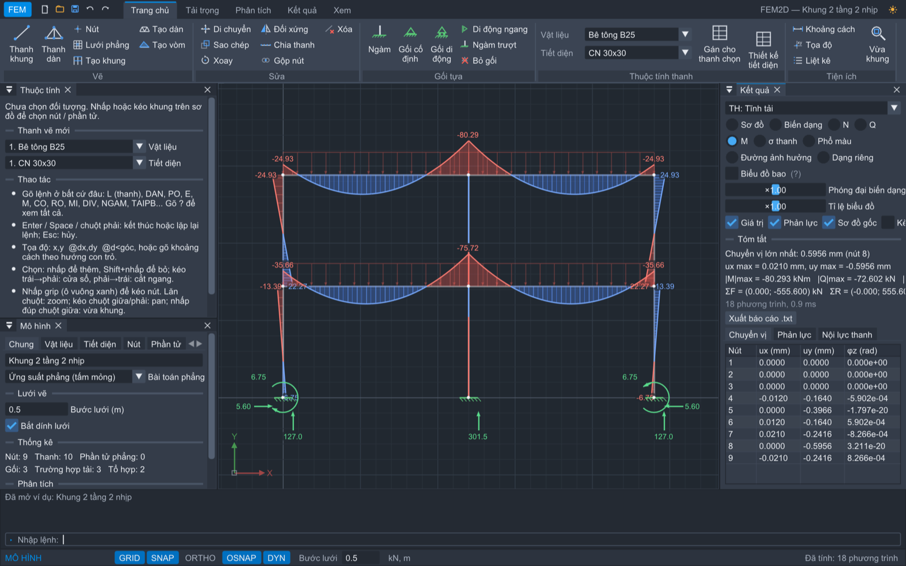 | 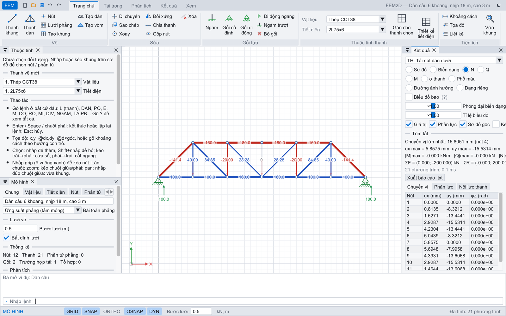 |
| Biểu đồ M vẽ về phía thớ căng, phản lực | Dàn: thanh kéo (xanh) / nén (đỏ), giao diện sáng |
| 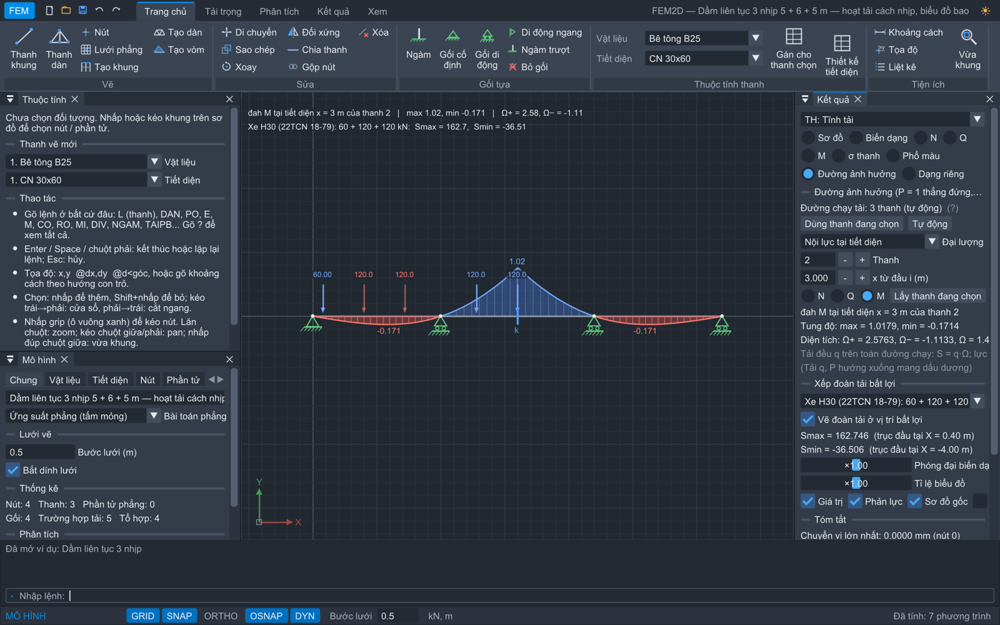 | 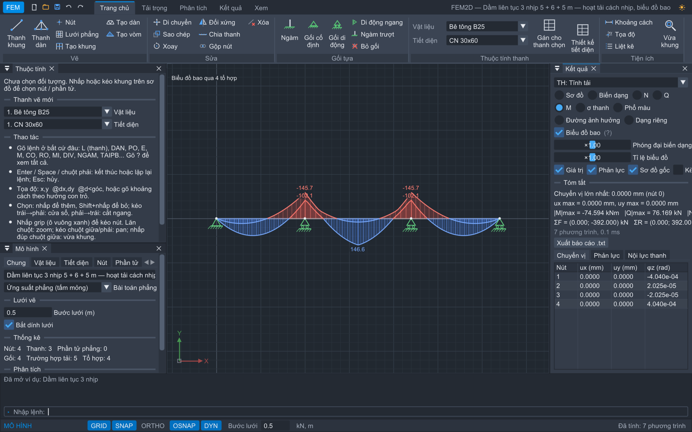 |
| Đường ảnh hưởng M, xếp đoàn xe H30 bất lợi | Biểu đồ bao M qua các tổ hợp hoạt tải cách nhịp |
| 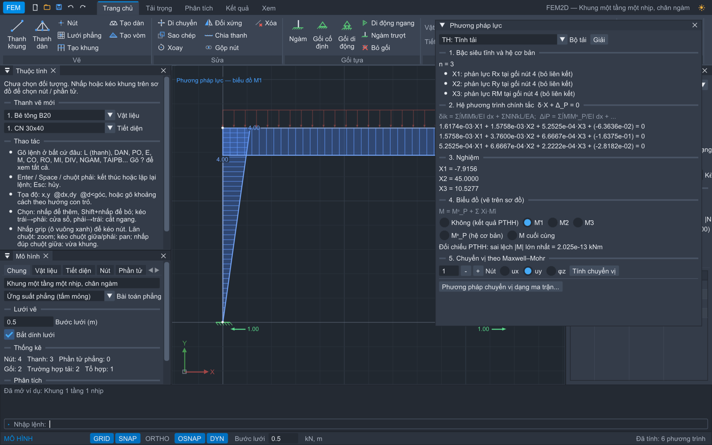 | 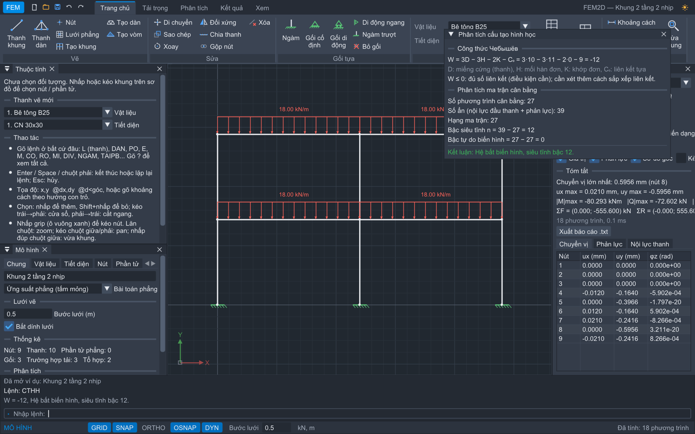 |
| Phương pháp lực: hệ cơ bản, biểu đồ đơn vị M̄1, hệ phương trình chính tắc | Phân tích cấu tạo hình học: W, bậc siêu tĩnh |
| 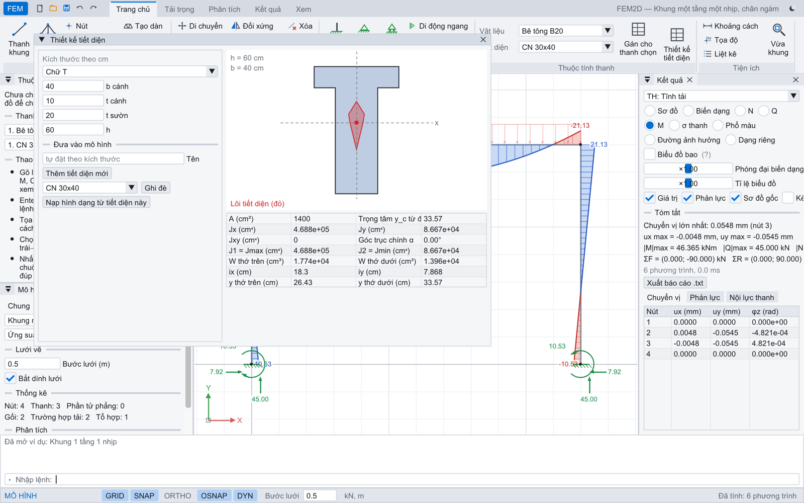 | 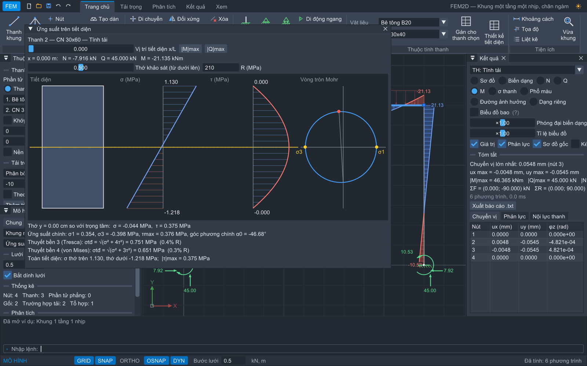 |
| Đặc trưng hình học, trục chính, lõi tiết diện | σ(y), τ(y), vòng tròn Mohr, thuyết bền 3, 4 |
| 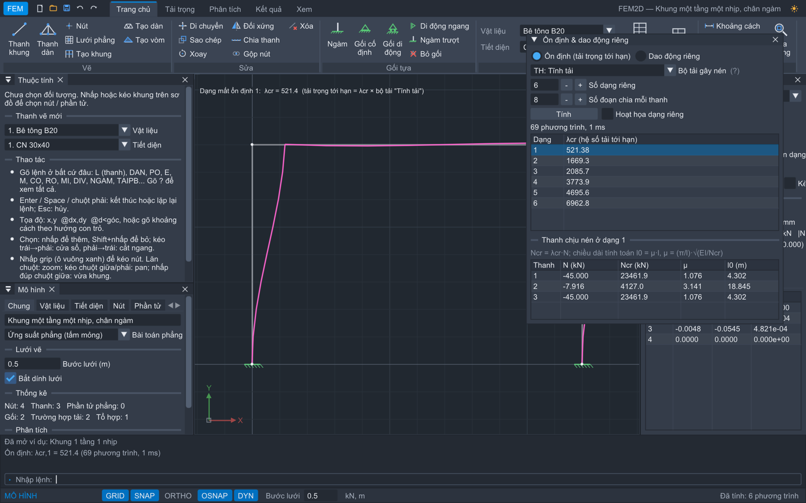 | 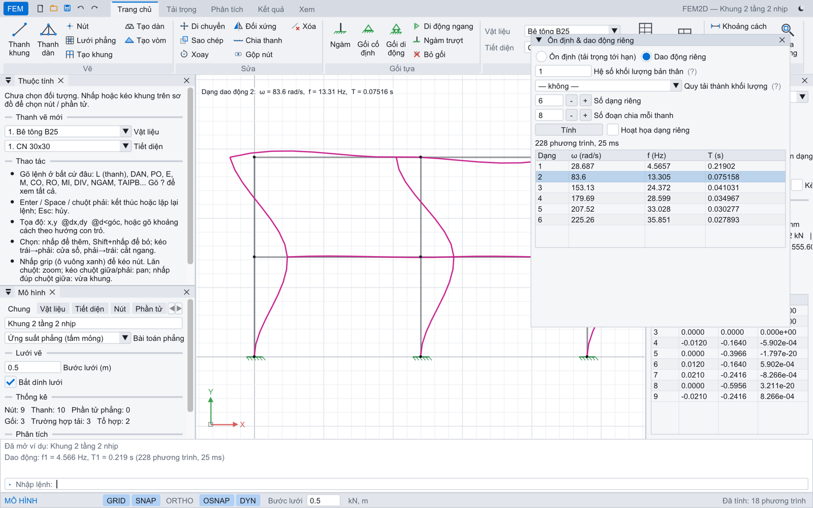 |
| Ổn định: λcr, hệ số chiều dài tính toán μ | Dao động riêng: tần số, chu kỳ, dạng dao động |
| 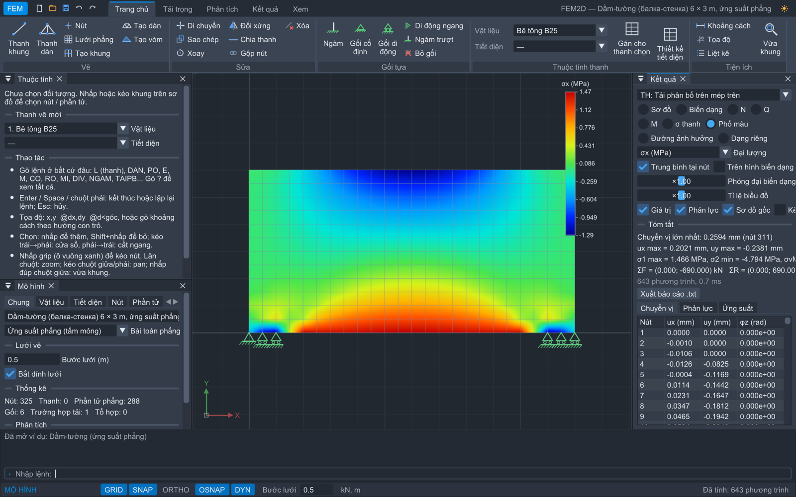 | 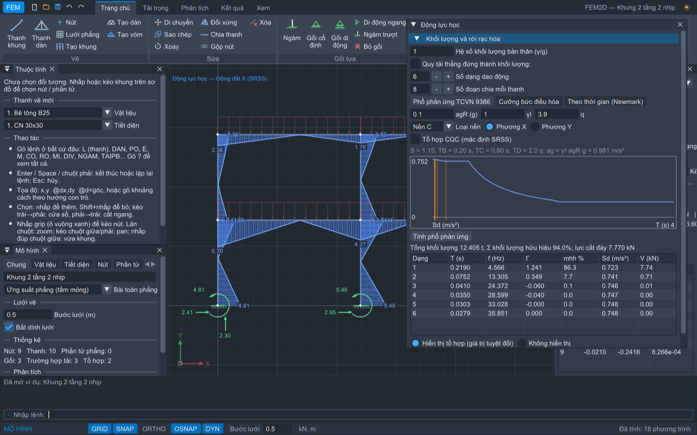 |
| Dầm-tường (балка-стенка): phổ màu σx, phần tử Q4 | Phổ phản ứng TCVN 9386: phổ thiết kế, khối lượng hữu hiệu, nội lực SRSS |
| 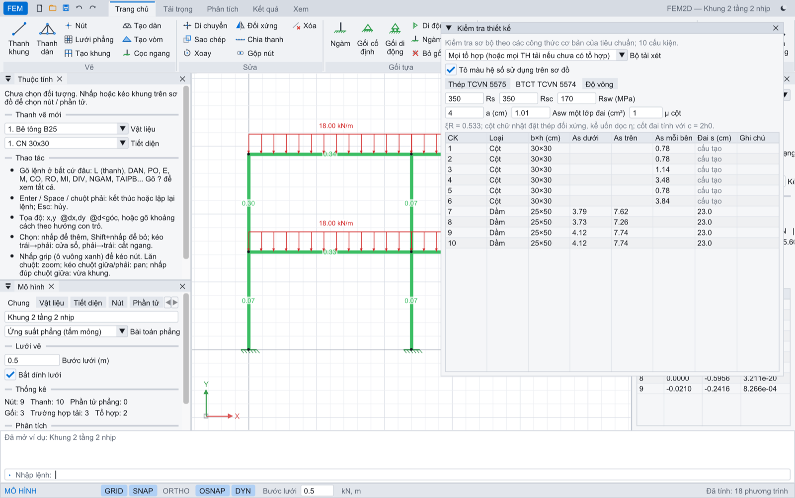 | |
| Kiểm tra thiết kế: cốt thép dầm, cột theo TCVN 5574:2018, tô màu trên sơ đồ | |

## Biên dịch

Yêu cầu: CMake ≥ 3.20, trình biên dịch C++17, SDL3 (nếu hệ thống không có, CMake sẽ tự tải mã nguồn).
Dear ImGui (v1.92.9b-docking) được CMake tải tự động.

```sh
# macOS
brew install cmake ninja sdl3
cmake -S . -B build -G Ninja -DCMAKE_BUILD_TYPE=Release
cmake --build build
./build/fem_tests          # các phép kiểm tra so với lời giải giải tích
./build/fem2d              # mở giao diện
./build/fem2d examples/khung_2_tang_2_nhip.fem
```

Tùy chọn CMake: `-DFEM_BUILD_GUI=OFF` (chỉ lõi tính + test), `-DFEM_IMGUI_DIR=/đường/dẫn/imgui` (dùng ImGui có sẵn, không cần mạng).

## Tính năng

**Phần tử**
- Thanh dàn (chỉ kéo nén; tải trong nhịp quy về nút như dầm đơn giản).
- Thanh khung Euler–Bernoulli: khớp đầu thanh (giải phóng mômen bằng khử tĩnh), dầm trên nền đàn hồi Winkler
  (ma trận nền tương thích), tải nhiệt độ (t đều và chênh lệch Δt).
- Tam giác biến dạng hằng (CST), tứ giác Q4 đẳng tham số có tùy chọn mode không tương thích QM6 (Wilson–Taylor).
- Bài toán ứng suất phẳng / biến dạng phẳng.

**Tải trọng**: tải nút (Fx, Fy, Mz); trên thanh: phân bố hình thang (theo trục cục bộ, tổng thể, hoặc trên hình chiếu),
tập trung, mômen tập trung, nhiệt độ, sai số chế tạo ΔL; trọng lượng bản thân; chuyển vị cưỡng bức (lún gối); gối đàn hồi.

**Nền**: Winkler, hai hệ số Pasternak / Власов, nền chỉ chịu nén (phân tích lặp, đoạn dầm vểnh lên tách khỏi nền).

**Phân tích bậc hai** (tính theo sơ đồ biến dạng, P-Δ và P-δ): lặp với ma trận độ cứng hình học đến khi hội tụ,
báo mất ổn định khi tải vượt tải trọng tới hạn.

**Cấu tạo hình học** (lệnh `CTHH`): W = 3D − 3H − 2K − C₀, hạng ma trận cân bằng, bậc siêu tĩnh, kết luận
bất biến hình / biến hình / tức thời biến hình và hiển thị dạng chuyển động của cơ cấu.
Nhiều trường hợp tải và tổ hợp tải tuyến tính.

**Kết quả**: chuyển vị, phản lực, biểu đồ N, Q, M, ứng suất pháp thớ biên N/A ± M/W, hình biến dạng (đường đàn hồi
chính xác trong nhịp), phổ màu ux, uy, |u|, σx, σy, τxy, σ1, σ2, σ von Mises; xuất báo cáo `.txt`.

**Biểu đồ bao** N, Q, M qua các tổ hợp (ví dụ hoạt tải cách nhịp của dầm liên tục).

**Đường ảnh hưởng** (đah) do lực P = 1 thẳng đứng di chuyển trên đường chạy tải (tự động hoặc chọn thanh):
phản lực gối, nội lực N/Q/M tại tiết diện bất kỳ (có bước nhảy đúng tại tiết diện), chuyển vị nút; kèm tung độ
max/min và diện tích Ω⁺, Ω⁻ để tính S = q·Ω, S = P·y.

**Ổn định** (phương pháp chuyển vị với ma trận độ cứng hình học): hệ số tải trọng tới hạn λcr, các dạng mất
ổn định, lực tới hạn Ncr và hệ số chiều dài tính toán μ (l0 = μ·l) của từng thanh chịu nén.

**Dao động riêng**: tần số ω, f, chu kỳ T và dạng dao động (có hoạt họa); khối lượng từ trọng lượng bản thân
và/hoặc quy từ tải trọng thẳng đứng của một bộ tải (m = |Fy|/g).

**Tổ hợp tải trọng tự động theo TCVN 2737:1995**: phân loại tải thường xuyên/tạm thời, nhóm loại trừ
(gió trái/phải, các sơ đồ chất hoạt tải), hệ số độ tin cậy γf; sinh tổ hợp cơ bản 1 (ψ = 1) và cơ bản 2 (ψ = 0,9).

**Tiết diện** (Sức bền vật liệu, lệnh `TIETDIEN`): chữ nhật, T, I không đối xứng, hộp, ống, tròn, [, L, đa giác tùy ý
có lỗ → A, trọng tâm, Jx, Jy, Jxy, mômen quán tính chính và góc trục chính, W thớ trên/dưới, bán kính quán tính,
**lõi tiết diện**. Ứng suất σ trên biểu đồ dùng đúng khoảng cách thớ trên/dưới của tiết diện không đối xứng.

**Ứng suất trên tiết diện** (lệnh `USTD`): biểu đồ σ(y) = N/A − M·y/J, τ(y) = Q·S(y)/(J·b(y)), vòng tròn Mohr,
ứng suất chính và phương chính, kiểm tra theo thuyết bền 3 (Tresca) và 4 (von Mises).

**Lời giải theo giáo trình**:
- **Phương pháp lực** từng bước (lệnh `PPL`): bậc siêu tĩnh, hệ cơ bản (tự chọn ẩn thừa, ưu tiên phản lực gối),
  biểu đồ đơn vị M̄i và M⁰P vẽ trên sơ đồ, hệ số δik, ΔiP bằng nhân biểu đồ, hệ phương trình chính tắc, nghiệm,
  biểu đồ cuối cùng, đối chiếu với lời giải phần tử hữu hạn.
- **Chuyển vị theo Maxwell–Mohr**: biểu đồ do lực đơn vị trên hệ cơ bản nhân với biểu đồ cuối cùng.
- **Phương pháp chuyển vị dạng ma trận** (lệnh `PPCV`): ma trận độ cứng phần tử cục bộ và tổng thể, K, P, Z.
- **Xếp đoàn tải bất lợi** trên đường ảnh hưởng: xe H30, HL-93 (xe tải, xe hai trục, tải làn), НК-80 hoặc tự nhập.
- **Vòm** parabol / cung tròn, hai khớp / ba khớp / ngàm (lệnh `VOM`); **thanh vút** (tiết diện thay đổi, lệnh `VUT`).

**Động lực học** (lệnh `DONGLUC`):
- **Phổ phản ứng TCVN 9386:2012**: phổ thiết kế loại 1, nền A–E, agR, γI, q; hệ số tham gia, khối lượng hữu hiệu
  (cảnh báo khi < 90%), lực cắt đáy từng dạng, tổ hợp SRSS / CQC, nội lực tổ hợp và từng dạng vẽ trên sơ đồ.
- **Dao động cưỡng bức điều hòa** (không cản): biên độ, hệ số động, cảnh báo cộng hưởng.
- **Phân tích theo thời gian** (Newmark gia tốc trung bình, cản Rayleigh): tải bậc thang, xung chữ nhật, nửa sin,
  điều hòa, gia tốc nền dạng sin hoặc nhập bảng (t, a); đồ thị u(t), nội lực tại từng thời điểm, hoạt họa.
- Khối lượng từ trọng lượng bản thân và/hoặc quy từ tải trọng thẳng đứng của một bộ tải.

**Kiểm tra thiết kế sơ bộ** (lệnh `KTTK`), tự nhóm các phần tử thẳng hàng thành cấu kiện:
- **Thép TCVN 5575:2012**: bền N/A ± M/W, ổn định với hệ số φ theo độ mảnh quy ước λ̄ (μ mặc định hoặc lấy từ
  phân tích ổn định), cắt τ = VS/(It), độ mảnh giới hạn.
- **Bê tông cốt thép TCVN 5574:2018**: cốt thép dọc dầm (αm, ξR, cốt chịu nén khi αm > αR), cốt đai (c = 2h0),
  cột chữ nhật nén lệch tâm đặt thép đối xứng có kể uốn dọc η.
- **Độ võng** so với dây cung, giới hạn L/n.
- Hệ số sử dụng tô màu trực tiếp trên sơ đồ.
- Vật liệu có cường độ tính toán (thép f; bê tông Rb, Rbt) theo TCVN.

**Cọc chịu tải ngang theo phương pháp "m"** (lệnh `COC`): hệ số nền tăng tuyến tính theo độ sâu, bề rộng quy ước bp.

**Liên thông AutoCAD — DXF**: nhập bản vẽ (LINE, LWPOLYLINE, POLYLINE; lọc theo lớp; đơn vị mm/cm/m; tự gộp nút và cắt
thanh tại điểm nối chữ T) và xuất sơ đồ, biểu đồ nội lực, giá trị, hình biến dạng ra DXF R12 theo các lớp riêng
(`FEM_THANH`, `FEM_BIEUDO_DUONG`, `FEM_BIEUDO_AM`, `FEM_GIATRI`...). Lệnh `DXFIN`, `DXFOUT`.

**Báo cáo HTML có hình** (lệnh `BAOCAO`): sơ đồ, dữ liệu, biểu đồ M, Q, N, hình biến dạng (SVG), bảng phản lực,
chuyển vị, nội lực; mở bằng trình duyệt và in ra PDF.

**Tải trên cạnh phần tử phẳng**: lực phân bố qx, qy hoặc áp lực pháp tuyến biến đổi tuyến tính p = p0 + k·y
(ví dụ áp lực thủy tĩnh), quy về lực nút tương đương.

**Giao diện kiểu AutoCAD** (sáng/tối): ribbon có biểu tượng, dòng lệnh, thanh trạng thái GRID/SNAP/ORTHO/OSNAP/DYN,
con trỏ chữ thập, bắt điểm (nút, trung điểm, giao điểm, vuông góc, gần nhất — vẽ vào giữa thanh sẽ tự cắt thanh để nối),
chọn cửa sổ (trái→phải) / cắt ngang (phải→trái), grip để kéo nút, nhập liệu động cạnh con trỏ, bảng thuộc tính,
hoàn tác/làm lại, tự động tính lại khi sửa, bộ tạo nhanh khung nhiều tầng, dàn, lưới phần tử phẳng.
Thư viện vật liệu TCVN 5574:2018, TCVN 5575:2012 và thép hình ГОСТ 8239-89 (chữ I), ГОСТ 8240-97 (chữ [).

## Quy ước

- Đơn vị: kN, m, °C; E nhập bằng kN/m²; chuyển vị hiển thị mm, ứng suất MPa.
- Trục X sang phải, Y hướng lên; mômen và góc xoay dương ngược chiều kim đồng hồ.
- Trục cục bộ thanh: x từ nút i → j, y quay x ngược chiều kim đồng hồ 90°.
- N > 0 kéo; Q > 0 làm phần thanh quay thuận chiều kim đồng hồ; M > 0 căng thớ dưới (phía −y cục bộ).

## Thao tác (giống AutoCAD)

Gõ lệnh ở bất cứ đâu, không cần nhấp vào dòng lệnh. **Enter / Space / chuột phải** để kết thúc hoặc lặp lại lệnh,
**Esc** để hủy. Lệnh không phân biệt hoa thường; gõ `?` để xem danh sách.

| Lệnh | Chức năng |
|---|---|
| `L` / `DAN` / `PO` | vẽ thanh khung / thanh dàn / nút |
| `E`, `M`, `CO`, `RO`, `MI` | xóa, di chuyển, sao chép, xoay, đối xứng |
| `DIV`, `GOP` | chia thanh thành n đoạn, gộp nút trùng |
| `NGAM`, `KHOP`, `DIDONG`, `DIDONGX`, `NGAMTRUOT`, `BOGOI` | gối tựa |
| `TAINUT`, `TAIPB`, `TAITT`, `MOMEN` | tải nút, tải phân bố, lực tập trung, mômen |
| `TINH` (F5), `PDELTA`, `CTHH` | tính tĩnh, bật/tắt P-Δ, cấu tạo hình học |
| `DXFIN`, `DXFOUT`, `BAOCAO` | nhập/xuất DXF, báo cáo HTML |
| `KTTK`, `COC` | kiểm tra thiết kế, tạo cọc chịu tải ngang |
| `ONDINH`, `DAODONG`, `DONGLUC` | ổn định, dao động riêng, động lực học |
| `TIETDIEN`, `USTD` | thiết kế tiết diện, ứng suất trên tiết diện |
| `PPL`, `PPCV`, `VOM`, `VUT` | phương pháp lực, phương pháp chuyển vị ma trận, tạo vòm, thanh vút |
| `DI`, `ID`, `LI`, `Z` | đo khoảng cách, tọa độ, liệt kê, zoom (`E` toàn bộ, `W` cửa sổ) |
| `U`, `REDO` | hoàn tác, làm lại |

Nhập tọa độ: `x,y` (tuyệt đối), `@dx,dy` (tương đối), `@d<góc` (cực), hoặc gõ một số để đi theo hướng con trỏ.

| Phím / chuột | Chức năng |
|---|---|
| F3 / F7 / F8 / F9 / F12 | OSNAP / lưới / ORTHO / SNAP / nhập liệu động |
| F2 | mở rộng lịch sử dòng lệnh |
| Ctrl+1 | bảng thuộc tính |
| Ctrl+Z / Ctrl+Y, Ctrl+S, Delete | hoàn tác / làm lại, lưu, xóa |
| Lăn chuột | zoom quanh con trỏ; kéo chuột giữa/phải: pan; nhấp đúp chuột giữa: vừa khung |
| Nhấp / Shift+nhấp | thêm / bỏ đối tượng khỏi tập chọn; nhấp vào grip để kéo nút |

## Định dạng file `.fem`

File văn bản, mỗi dòng một khai báo, chỉ số đánh từ 1, `#` là chú thích. Xem các ví dụ trong `examples/`.

```
MATERIAL "Bê tông B20" 27500000 0.2 1e-05 25      # tên E nu alpha gamma
SECTION "CN 30x60" 0.18 0.0054 0.6                 # tên A I h
NODE 0 0
FRAME 1 2 1 1 0 0 0                                # n1 n2 vật_liệu tiết_diện khớp_i khớp_j kf
SUPPORT 1 1 1 1 0 0 0                              # nút khóa_x khóa_y khóa_φ kx ky kφ
LOADCASE "Tĩnh tải" 1                              # tên hệ_số_trọng_lượng_bản_thân
  ELOAD 2 DIST GY -15 -15 0                        # phần_tử DIST hướng q1 q2 theo_hình_chiếu
  NLOAD 2 10 0 0                                   # nút Fx Fy Mz
COMBO "TT + 0,9Gió" 1 1.0 2 0.9
```

## Cấu trúc mã nguồn

```
src/core/   lõi tính toán, không phụ thuộc giao diện
  Model         dữ liệu mô hình
  Elements      ma trận độ cứng, tải tương đương, nội lực phần tử
  Skyline       ma trận skyline + phân tích LDLᵀ (COLSOL)
  Analysis      lắp ghép, đánh số lại RCM, điều kiện biên, giải, hậu xử lý, phát hiện hệ biến hình
  PostProcess   biểu đồ bao, đường ảnh hưởng
  Eigen         ổn định, dao động riêng (Householder + QL cho ma trận đối xứng)
  Kinematics    phân tích cấu tạo hình học (ma trận cân bằng, hạng, không gian rỗng)
  SectionGeom   đặc trưng hình học tiết diện, lõi tiết diện, mômen tĩnh và bề rộng tại cao độ
  ForceMethod   phương pháp lực, Maxwell–Mohr, phương pháp chuyển vị dạng ma trận
  Dynamics      phổ phản ứng TCVN 9386, dao động cưỡng bức, Newmark
  Design        cấu kiện, kiểm tra thép, BTCT, độ võng, cọc phương pháp m
  Dxf, Report   nhập/xuất DXF, báo cáo HTML có hình SVG
  Mesher        tạo lưới, chia thanh
  Library       vật liệu, thép hình
  ModelIO       đọc/ghi .fem, báo cáo
  Examples      bài toán mẫu
src/app/    giao diện SDL3 + ImGui (Ribbon: ribbon, dòng lệnh, chủ đề; Commands: các lệnh; View: vùng vẽ; Panels: bảng)
tests/      kiểm chứng với lời giải giải tích
```

Các ảnh trên được chụp tự động bằng chế độ dành cho phát triển: `fem2d --shot ảnh.bmp <số ví dụ> <chế độ xem> [đại lượng màu] [e | m<thanh>:<x>]` chụp màn hình rồi thoát;
`fem2d --smoke` giả lập gõ lệnh và thao tác chuột như người dùng để kiểm tra giao diện.

## Tài liệu tham khảo

- Lều Thọ Trình — Cơ học kết cấu, tập 1–2.
- Дарков А.В., Шапошников Н.Н. — Строительная механика.
- Смирнов А.Ф. и др. — Строительная механика. Стержневые системы.
- Варвак П.М. и др. — Метод конечных элементов; Zienkiewicz, Taylor — The Finite Element Method.
- Жемочкин Б.Н. — Расчёт балок на упругом основании.
- Смирнов А.Ф. — Устойчивость и колебания сооружений; СП 16.13330 (chiều dài tính toán cột khung).
- TCVN 2737:1995 — Tải trọng và tác động.
